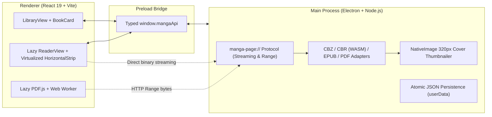

# KomaRoll — Sidescroller Manga Reader

**English** | [Português (BR)](./README.pt-BR.md)

A fast, lightweight, offline-first desktop **Manga Reader** built around a smooth **continuous horizontal sidescroller** experience (Right-to-Left by default, with Left-to-Right and Page-Snap toggles). Opens **CBZ, CBR, EPUB, and PDF** files natively with a built-in local library, automatic cover thumbnails, reading progress tracking, and bookmarks.


---

## Features

### Horizontal Sidescroller Reader
- **Continuous Horizontal Strip (Default)**: Seamless side-by-side manga strip with configurable page gap (`0px`–`32px`), smooth mouse-wheel-to-horizontal translation, and click-and-drag panning.
- **RTL & LTR Reading Directions**: Defaults to Right-to-Left (`RTL ←`) for manga (auto-detected from `ComicInfo.xml` and EPUB OPF metadata when present) with instant one-key toggle to Left-to-Right (`LTR →`).
- **Optional Page-Snap Mode**: Toggle between free continuous scrolling and crisp center-locked page snapping (`M`).
- **Fit & Zoom Modes**: `Fit Height`, `Fit Screen`, `Original`, and custom zoom (`50%`–`300%`) with viewport-center anchor preservation.
- **Distraction-Free Auto-Hiding HUD**: Glassmorphic top/bottom overlays with a direction-aware horizontal scrubber, clickable bookmark ticks, direct page jump, canvas background themes (`Obsidian`, `Slate`, `AMOLED Black`, `Paper`), and a slide-over Bookmarks drawer.

### Local Library & Persistence
- **Multi-Folder Scanning**: Add local folders to recursively discover `.cbz`, `.cbr`, `.epub`, and `.pdf` files with automatic series grouping.
- **Instant Drag-and-Drop**: Drop any supported file anywhere onto the window (or use **Open File** / Windows **Open With**) to start reading immediately.
- **Continue Reading & Bookmarks**: Automatically saves exact reading progress, recent history, and custom-labeled per-book bookmarks locally in Electron `userData` via atomic JSON writes.
- **Search & Filters**: Filter by format (`CBZ`, `CBR`, `EPUB`, `PDF`), reading status (`Unread`, `Reading`, `Completed`), folder, or search query, and sort by recently read, title, or date added.

---

## Supported Formats

| Format | Engine | Details |
| :--- | :--- | :--- |
| **CBZ** | `node-stream-zip` | Lazy ZIP Central Directory indexing (no full-archive RAM load), natural numeric page sorting (`page2` before `page10`), junk filtering (`__MACOSX`, `.DS_Store`, `Thumbs.db`), `ComicInfo.xml` metadata & RTL detection. |
| **CBR** | `node-unrar-js` (WASM) | Pure WebAssembly RAR4 & RAR5 extraction (no external `unrar.exe`), magic-byte detection automatically rescues renamed ZIP-as-CBR files, single-pass mutex-safe extraction, and forward batching for solid archives. |
| **EPUB** | `node-stream-zip` + `fast-xml-parser` | Parses `container.xml` and `.opf` manifest/spine/RTL direction. Automatically extracts fixed-layout manga spine images directly as native raster pages, with sandboxed XHTML iframe fallback for mixed/text chapters. |
| **PDF** | `pdfjs-dist` + Web Worker | Streamed over HTTP `Range` requests via the custom `manga-page://` protocol and rendered onto DPR/zoom-aware `<canvas>` surfaces for razor-sharp lineart and small text at up to 300% zoom. |

---

## Controls & Keyboard Shortcuts

### Mouse & Trackpad
| Input | Action |
| :--- | :--- |
| **Mouse Wheel Up / Down** | Smooth horizontal sidescrolling (wheel down advances to the next page in both RTL & LTR; invertible in settings) |
| **Horizontal Trackpad / Wheel** | Native horizontal scroll |
| **Click & Drag** | Pan horizontally (and vertically when zoomed past viewport height) |
| **Single Click (Canvas)** | Toggle HUD visibility |
| **`Ctrl` + Mouse Wheel** | Zoom in / out |
| **`Shift` + Mouse Wheel** | Vertical scroll when zoomed taller than viewport |

### Keyboard
| Shortcut | Action |
| :--- | :--- |
| `←` / `A` and `→` / `D` | Navigate pages (respects RTL / LTR direction) |
| `Space` / `Shift + Space` | Next page / Previous page |
| `Home` / `End` | Jump to first / last page |
| `+` (`=`) / `-` | Zoom in / Zoom out |
| `0` | Reset zoom to `100%` (`Fit Height`) |
| `R` | Toggle reading direction (`RTL ←` / `LTR →`) |
| `M` | Toggle reading mode (`Continuous Strip` / `Page Snap`) |
| `B` | Add or remove bookmark on the current page |
| `F` | Toggle fullscreen |
| `Esc` | Return to Library (auto-saves progress) |

---

## Architecture & Performance



### Lightweight Engineering Highlights
- **Zero Native C++ Addons**: Runs cleanly on Windows and modern Node.js (tested on Node 24) with no `node-gyp` or Visual Studio Build Tools required.
- **Custom `manga-page://` Protocol**: Streams raw image bytes, EPUB assets, cached thumbnails, and PDF byte-ranges directly to Chromium instead of passing base64 strings over IPC.
- **Zero-Re-Render Sidescrolling**: Scroll offsets live in refs; React only updates when the virtualized page window changes, paired with a persistent non-aborting image preloader and explicit PDF canvas GPU memory release on unmount.
- **Code-Split Startup**: `ReaderView` and `pdfjs-dist` load lazily on demand, keeping initial startup JS at **~255 KB**.
- **Compact Thumbnails & Packaging**: Cover scans are downscaled to 320px JPEGs (~25 KB) via Electron's built-in `nativeImage`; packaged `app.asar` is **~2.15 MB** and the standalone Windows portable executable is **~65.5 MB**.

---

## Getting Started

### Prerequisites
- **Node.js** `20+` (verified on `v24.11.0`) and **npm**

### Install & Run in Development
```powershell
npm install
npm run dev
```

### Run Typecheck & Automated Tests
```powershell
npm run typecheck
npm run test
```

### Build the Windows Portable Executable
```powershell
npm run package:win
```

Output artifacts are generated in `release/`:
- `release/KomaRoll-0.1.0-portable.exe` — Standalone single-file portable executable (double-click to run anywhere, no installation required).
- `release/win-unpacked/KomaRoll.exe` — Unpacked executable for instant zero-extract launching.

---

## Project Structure

```text
MangaReader/
├── build/                      # Generated multi-res Windows icon (icon.ico)
├── scripts/
│   ├── build-electron.mjs      # esbuild bundler for main & preload
│   ├── dev.mjs                 # Cross-platform Vite + Electron dev runner
│   └── generate-icon.mjs       # Pure-Node multi-resolution ICO generator
├── src/
│   ├── main/
│   │   ├── formats/            # Magic-byte detector, CBZ, CBR (WASM), EPUB, PDF adapters
│   │   ├── library/            # Recursive folder scanner & nativeImage thumbnailer
│   │   ├── storage/            # Atomic JSON persistence (library, progress, bookmarks, settings)
│   │   ├── protocol.ts         # Custom manga-page:// streaming protocol
│   │   └── index.ts            # Electron window & IPC handlers
│   ├── preload/
│   │   └── index.ts            # Secure contextBridge window.mangaApi
│   ├── renderer/
│   │   ├── library/            # LibraryView & BookCard cover grid
│   │   ├── reader/             # HorizontalStrip, sidescrollerMath, HUD, Image/PDF/EPUB slots
│   │   ├── store/              # Zustand application state
│   │   └── styles/             # Tailwind CSS v4 dark cinema theme
│   └── shared/                 # Shared domain types & IPC channel contracts
├── package.json
├── vite.config.ts
└── vitest.config.ts
```
