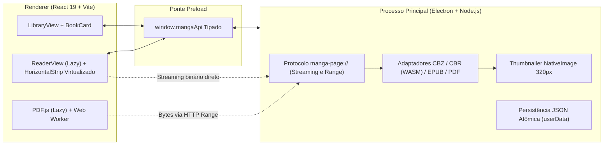

# KomaRoll — Leitor de Mangá Sidescroller

[English](./README.md) | **Português (BR)**

Um **Leitor de Mangá** desktop rápido, leve e offline-first projetado em torno de uma experiência fluida de **rolagem horizontal contínua (sidescroller)** — da direita para a esquerda por padrão, com alternância para esquerda-para-direita e modo encaixe por página (*Page-Snap*). Abre arquivos **CBZ, CBR, EPUB e PDF** nativamente com biblioteca local integrada, capas em miniatura automáticas, progresso de leitura e favoritos.


---

## Funcionalidades

### Leitor Horizontal Sidescroller
- **Faixa Horizontal Contínua (Padrão)**: Páginas dispostas lado a lado com espaçamento configurável (`0px`–`32px`), conversão suave da rodinha do mouse para rolagem horizontal e arraste com o mouse (*click-and-drag*).
- **Direção RTL e LTR**: Inicia no sentido japonês da direita para a esquerda (`RTL ←`), com detecção automática via `ComicInfo.xml` e metadados OPF de EPUB, e alternância instantânea para `LTR →`.
- **Modo Encaixe por Página (*Page-Snap*)**: Alterne a qualquer momento entre rolagem contínua livre e encaixe centralizado página a página (`M`).
- **Modos de Ajuste e Zoom**: `Fit Height` (ajustar à altura), `Fit Screen` (ajustar à tela), `Original` e zoom personalizado (`50%`–`300%`) preservando o ponto focal no centro da tela.
- **HUD Inteligente sem Distrações**: Barras superior e inferior translúcidas que se ocultam automaticamente, barra de navegação (*scrubber*) adaptada à direção RTL/LTR com marcadores de favoritos, salto direto para número de página, temas de fundo (`Obsidian`, `Slate`, `AMOLED Black`, `Paper`) e gaveta lateral de Favoritos.

### Biblioteca Local e Persistência
- **Varredura de Pastas Locais**: Adicione pastas para descobrir recursivamente arquivos `.cbz`, `.cbr`, `.epub` e `.pdf`, com agrupamento automático por série.
- **Arrastar e Soltar (*Drag-and-Drop*)**: Arraste qualquer arquivo suportado para a janela (ou use **Open File** / **Abrir com** do Windows) para começar a ler imediatamente.
- **Continuar Lendo e Favoritos**: Salva automaticamente a página atual, histórico recente e favoritos com rótulos personalizados por volume usando escrita atômica em JSON no diretório `userData` do Electron.
- **Busca e Filtros**: Filtre por formato (`CBZ`, `CBR`, `EPUB`, `PDF`), status de leitura (`Unread`, `Reading`, `Completed`), pasta ou busca textual, ordenando por lidos recentemente, título ou data de adição.

---

## Formatos Suportados

| Formato | Motor | Detalhes |
| :--- | :--- | :--- |
| **CBZ** | `node-stream-zip` | Leitura sob demanda do Diretório Central ZIP (sem carregar o arquivo inteiro na RAM), ordenação numérica natural (`page2` antes de `page10`), filtragem de lixo (`__MACOSX`, `.DS_Store`, `Thumbs.db`), leitura de metadados e flag RTL de `ComicInfo.xml`. |
| **CBR** | `node-unrar-js` (WASM) | Extração pura em WebAssembly para RAR4 e RAR5 (sem depender de `unrar.exe`), detecção por *magic bytes* que abre automaticamente arquivos ZIP renomeados para `.cbr`, inicialização em passo único com trava contra concorrência e extração em lotes para arquivos sólidos. |
| **EPUB** | `node-stream-zip` + `fast-xml-parser` | Interpreta `container.xml` e `.opf` (manifesto, *spine* e direção RTL). Extrai diretamente as imagens de EPUBs de mangá/layout fixo como páginas nativas e usa fallback em `iframe` XHTML isolado para capítulos com texto/layout misto. |
| **PDF** | `pdfjs-dist` + Web Worker | Transmitido por requisições HTTP `Range` via protocolo customizado `manga-page://` e renderizado em `<canvas>` sensível a DPI e zoom, mantendo traços e textos pequenos nítidos até 300% de zoom. |

---

## Controles e Atalhos de Teclado

### Mouse e Trackpad
| Entrada | Ação |
| :--- | :--- |
| **Roda do Mouse (Cima / Baixo)** | Rolagem horizontal suave (rolar para baixo avança para a próxima página tanto em RTL quanto em LTR; invertível nas configurações) |
| **Rolagem Horizontal / Trackpad** | Rolagem horizontal nativa |
| **Clicar e Arrastar** | Mover a tira horizontalmente (e verticalmente quando o zoom exceder a altura da tela) |
| **Clique Simples (Área de Leitura)** | Mostrar / ocultar a HUD |
| **`Ctrl` + Roda do Mouse** | Aumentar / diminuir zoom |
| **`Shift` + Roda do Mouse** | Rolagem vertical quando a página estiver maior que a altura da janela |

### Teclado
| Atalho | Ação |
| :--- | :--- |
| `←` / `A` e `→` / `D` | Navegar entre páginas (respeitando direção RTL / LTR) |
| `Space` / `Shift + Space` | Próxima página / Página anterior |
| `Home` / `End` | Ir para a primeira / última página |
| `+` (`=`) / `-` | Aumentar / diminuir zoom |
| `0` | Redefinir zoom para `100%` (`Fit Height`) |
| `R` | Alternar direção de leitura (`RTL ←` / `LTR →`) |
| `M` | Alternar modo de rolagem (`Strip` contínuo / `Snap` por página) |
| `B` | Adicionar ou remover favorito na página atual |
| `F` | Alternar tela cheia |
| `Esc` | Voltar para a Biblioteca (salvando o progresso automaticamente) |

---

## Arquitetura e Performance



### Destaques de Otimização e Leveza
- **Zero Addons Nativos em C++**: Instala e compila de forma limpa no Windows e em versões recentes do Node.js (verificado no Node 24) sem exigir `node-gyp` ou Visual Studio Build Tools.
- **Protocolo Customizado `manga-page://`**: Transmite imagens, recursos internos de EPUB, capas em cache e trechos de PDF diretamente para o Chromium sem trafegar strings base64 via IPC.
- **Rolagem sem Re-renderizações**: O deslocamento horizontal é mantido em *refs*; o React só atualiza quando a janela virtualizada de páginas muda, combinado com pré-carregamento persistente de imagens e liberação explícita de memória de GPU dos `<canvas>` de PDF ao desmontar.
- **Inicialização com Code-Splitting**: `ReaderView` e `pdfjs-dist` são carregados sob demanda, mantendo o JavaScript inicial em **~255 KB**.
- **Miniaturas Compactas e Empacotamento Enxuto**: Capas são redimensionadas para JPEG de 320px (~25 KB) usando `nativeImage` nativo do Electron; o `app.asar` empacotado ocupa apenas **~2,15 MB** e o executável portátil para Windows pesa **~65,5 MB**.

---

## Como Executar

### Pré-requisitos
- **Node.js** `20+` (verificado em `v24.11.0`) e **npm**

### Instalar e Rodar em Desenvolvimento
```powershell
npm install
npm run dev
```

### Verificação de Tipos e Testes Automatizados
```powershell
npm run typecheck
npm run test
```

### Gerar o Executável Portátil para Windows
```powershell
npm run package:win
```

Os arquivos finais são gerados na pasta `release/`:
- `release/KomaRoll-0.1.0-portable.exe` — Executável portátil único (basta dar dois cliques para abrir em qualquer PC Windows, sem instalação).
- `release/win-unpacked/KomaRoll.exe` — Versão descompactada para abertura instantânea sem extração temporária.

---

## Estrutura do Projeto

```text
MangaReader/
├── build/                      # Ícone Windows multi-resolução gerado (icon.ico)
├── scripts/
│   ├── build-electron.mjs      # Bundler esbuild para main e preload
│   ├── dev.mjs                 # Runner de desenvolvimento Vite + Electron
│   └── generate-icon.mjs       # Gerador de .ico em Node.js puro
├── src/
│   ├── main/
│   │   ├── formats/            # Detector magic-bytes e adaptadores CBZ, CBR (WASM), EPUB e PDF
│   │   ├── library/            # Scanner recursivo de pastas e thumbnailer via nativeImage
│   │   ├── storage/            # Persistência atômica em JSON (biblioteca, progresso, favoritos, ajustes)
│   │   ├── protocol.ts         # Protocolo customizado manga-page://
│   │   └── index.ts            # Janela Electron e handlers IPC
│   ├── preload/
│   │   └── index.ts            # Ponte segura contextBridge (window.mangaApi)
│   ├── renderer/
│   │   ├── library/            # LibraryView e grade de capas BookCard
│   │   ├── reader/             # HorizontalStrip, sidescrollerMath, HUD e slots Image/PDF/EPUB
│   │   ├── store/              # Gerenciamento de estado com Zustand
│   │   └── styles/             # Tema escuro com Tailwind CSS v4
│   └── shared/                 # Tipos de domínio compartilhados e contrato IPC
├── package.json
├── vite.config.ts
└── vitest.config.ts
```
